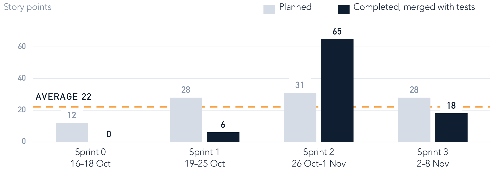

# Velocity

Velocity = points of the stories that met the Definition of Done in that sprint (spec §9.5). Partly done
stories count zero and carry over with their full estimate.

**Counting rule for Sprints 0–3.** A story counts in the sprint in which it was merged to `develop` with
its tests and lint green. Two DoD items are not counted for these sprints: "working on staging", because
there was no hosted environment until 10 Nov (production on Railway), and "reviewed by a teammate",
because several stories were pushed straight to `develop` without a pull request. Dates come from the
merge commits.

| Sprint | Dates | Planned | Completed | Carried over | What was completed |
|---|---|---|---|---|---|
| 0 | 16–18 Oct | 12 | **0** | all 12 | Setup stories finished on 19–20 Oct (count in Sprint 1) and 29 Oct (Sprint 2) |
| 1 | 19–25 Oct | 28 | **6** | the ten S1 stories (28), S0-02, S0-05, S0-06 | S0-01 (1), S0-03 (3), S0-04 (2). The domain code was merged on 23 Oct (#4) without tests, so the S1 stories count in Sprint 2 |
| 2 | 26 Oct–1 Nov | 31 | **65** | S2-08 (5), S0-02 (2), S0-06 (1) | S0-05 (3); all ten S1 stories (28) once their tests landed on 29 Oct (#6–#10); S2-01, S2-02, S2-03, S2-04, S2-05, S2-06, S2-07, S2-09 (26); S3-02 and S3-03 merged early on Sun 1 Nov (8) |
| 3 | 2–8 Nov | 28 | **18** | S3-06 (2), S2-08 (5) | S3-01 (5), S3-04 (3), S3-05 (5), S3-07 (2), S3-08 (3) |
| 4 | 9–15 Nov | light sprint | in progress | | S4-01 diagrams (3) on 10 Nov; production on Railway on 10 Nov |

**Average velocity, Sprints 0–3: 22 points per sprint** (89 of 99 planned points done). The Sprint 1
forecast was 24.

**What the numbers show.** Sprint 1 looks empty because code was merged before its tests. The work
landed in Sprint 2 instead, which is why Sprint 2 is 65. Retro action: a story's tests go in the same
pull request as its code, so velocity shows up in the sprint where the work happened.

Regenerate the chart with the other figures: `./scripts/figures.sh`
